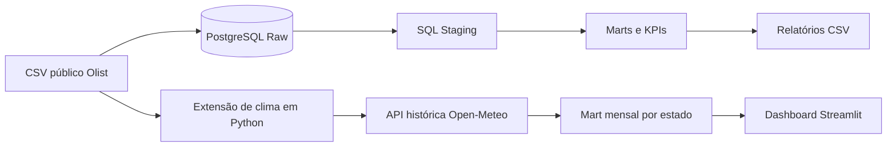

# Olist Data Warehouse

Projeto de portfólio de Engenharia de Dados com foco em ingestão, modelagem SQL e análise de desempenho logístico no e-commerce brasileiro.

**Stack principal:** Python, SQL, PostgreSQL e Docker.

## O que o projeto demonstra

- Ingestão de arquivos CSV para uma camada Raw em PostgreSQL.
- Padronização dos dados em Staging usando SQL.
- Modelagem de tabelas analíticas e KPIs em Marts.
- Exportação de relatórios de desempenho logístico e frete.

## Arquitetura



## Métricas

- **Lead time:** dias entre a compra e a entrega.
- **Atraso:** entrega após a data estimada.
- **Taxa de atraso e percentil 90 do lead time** por estado.
- **Frete médio e total** por estado e vendedor.

## Extensão: clima e atrasos

A pasta [`clima-logistica/`](clima-logistica/README.md) adiciona uma análise exploratória que combina o conjunto Olist com clima histórico. Ela produz um mart mensal por estado e um dashboard para comparar atrasos, chuva e temperatura. A metodologia usa uma coordenada representativa por estado; a análise não atribui causalidade ao clima.

## Dados

Baixe o [Brazilian E-Commerce Public Dataset by Olist](https://www.kaggle.com/datasets/olistbr/brazilian-ecommerce) e coloque os CSVs usados pelo pipeline em `data/olist/`:

```text
data/olist/olist_orders_dataset.csv
data/olist/olist_order_items_dataset.csv
data/olist/olist_customers_dataset.csv
data/olist/olist_sellers_dataset.csv
data/olist/olist_geolocation_dataset.csv
```

Os dados não são versionados neste repositório. Consulte os termos do conjunto original.

## Como executar o pipeline principal

Requisitos: Python 3.10 ou superior e Docker Desktop.

No PowerShell, a partir da raiz do repositório:

```powershell
python -m pip install -r requirements.txt
Copy-Item .env.example .env
docker compose up -d
python run_all.py
```

O arquivo `.env.example` contém a URL local do PostgreSQL correspondente às configurações padrão do Docker Compose.

Para instruções da extensão de clima, incluindo seus próprios passos de execução, consulte [`clima-logistica/README.md`](clima-logistica/README.md).

## Estrutura

```text
sql/                 Schemas, staging, marts e KPIs
src/                 CLI de orquestração e carga dos CSVs
tests/               Verificações de qualidade dos dados
data/olist/          Arquivos CSV locais, ignorados pelo Git
reports/             Relatórios CSV gerados pelo pipeline
clima-logistica/     Extensão com API meteorológica e dashboard
```
