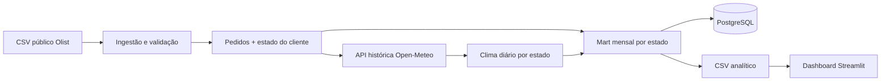

# Olist: clima e desempenho logístico

Projeto de engenharia de dados que combina pedidos do e-commerce Olist com dados meteorológicos históricos para investigar a relação entre chuva, temperatura e atrasos de entrega no Brasil.

> **Pergunta de negócio:** em quais estados e meses a taxa de atraso é maior, e como ela varia junto com as condições meteorológicas na data prevista de entrega?

## O que o projeto demonstra

- Ingestão e validação de arquivos CSV públicos.
- Integração com uma API externa de dados históricos.
- Transformação reproduzível em Python e pandas.
- Persistência do mart analítico em PostgreSQL.
- Dashboard interativo para explorar os resultados.
- Cache local para evitar chamadas meteorológicas repetidas.

## Arquitetura



## Indicadores

- Pedidos entregues por estado e mês da data prevista.
- Quantidade e percentual de pedidos entregues após a previsão.
- Tempo médio entre compra e entrega.
- Chuva acumulada e temperatura média na data prevista.
- Cobertura meteorológica dos pedidos analisados.

O projeto usa a data **prevista** de entrega para associar o clima ao momento em que o pedido deveria chegar. A análise é exploratória: associação entre clima e atraso não demonstra causalidade.

## Dados

Use os CSVs do projeto principal, disponíveis em `../data/olist/`, e copie estes três arquivos para `data/raw/` dentro desta extensão:

```text
data/raw/olist_orders_dataset.csv
data/raw/olist_customers_dataset.csv
data/raw/olist_geolocation_dataset.csv
```

Se ainda não baixou o conjunto, use o [Brazilian E-Commerce Public Dataset by Olist](https://www.kaggle.com/datasets/olistbr/brazilian-ecommerce). Os arquivos não são versionados neste repositório. Consulte e respeite os termos de uso do conjunto original.

O clima histórico vem da [API histórica Open-Meteo](https://open-meteo.com/en/docs/historical-weather-api). Para manter o volume de consultas e dados controlado, a localização representa a mediana das coordenadas disponíveis para cada estado no arquivo de geolocalização. Isso é uma aproximação regional, não uma medição no endereço de cada cliente.

## Como executar

Requisitos: Python 3.11 ou superior e Docker Desktop.

### 1. Preparar o ambiente

No PowerShell:

```powershell
py -3.11 -m venv .venv
.\.venv\Scripts\Activate.ps1
python -m pip install --upgrade pip
python -m pip install -e .
Copy-Item .env.example .env
```

### 2. Iniciar o PostgreSQL

```powershell
docker compose up -d db
```

Esta extensão usa a porta local `5433` para coexistir com o PostgreSQL do projeto principal.

### 3. Executar o pipeline

Depois de colocar os três CSVs em `data/raw/`:

```powershell
python -m olist_clima.pipeline
```

O pipeline cria `data/processed/mart_state_delivery_weather_monthly.csv`, grava a tabela `mart_state_delivery_weather_monthly` no PostgreSQL e salva o cache meteorológico em `data/intermediate/weather_daily.csv`.

### 4. Abrir o dashboard

```powershell
streamlit run dashboard/app.py
```

## Estrutura

```text
dashboard/                 Aplicação Streamlit
data/raw/                  CSVs baixados pelo usuário (ignorados pelo Git)
data/intermediate/         Cache de clima (ignorado pelo Git)
data/processed/            Mart gerado pelo pipeline (ignorado pelo Git)
src/olist_clima/           Ingestão, API, transformação e carga
compose.yaml               PostgreSQL local
```

## Limitações conhecidas

- A coordenada mediana por estado simplifica diferenças de clima dentro de estados extensos.
- A data prevista não representa necessariamente o dia em que o transporte passou pela região.
- Dados meteorológicos de reanálise são estimativas em grade geográfica.
- O dataset Olist cobre um período histórico específico e não representa o varejo atual.

## Próximos passos

- Acrescentar validações de qualidade para a tabela final.
- Incluir orquestração e atualização incremental do mart.
- Comparar resultados por estado, categoria e faixa de frete.

## Licença

O código deste projeto está sob licença MIT. A licença dos dados continua sendo a definida pelos respectivos provedores.
